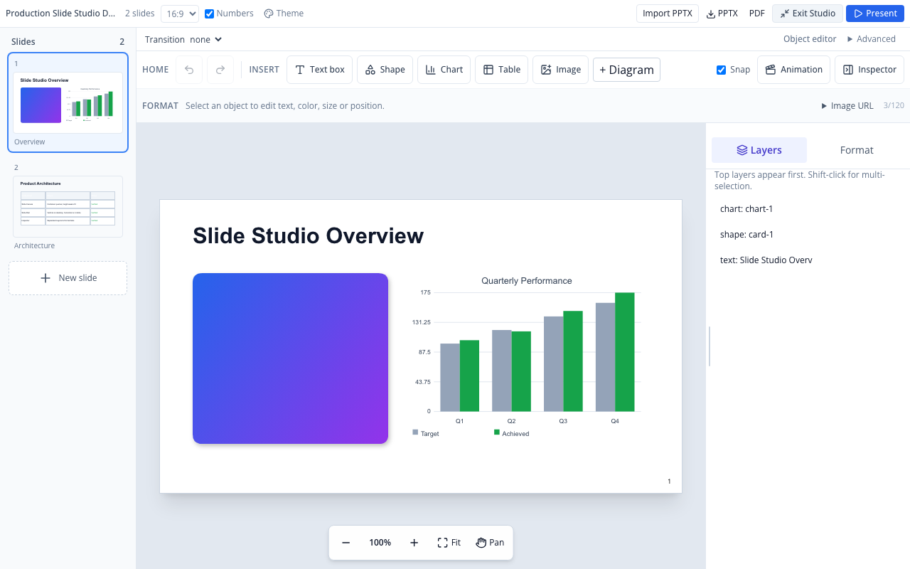
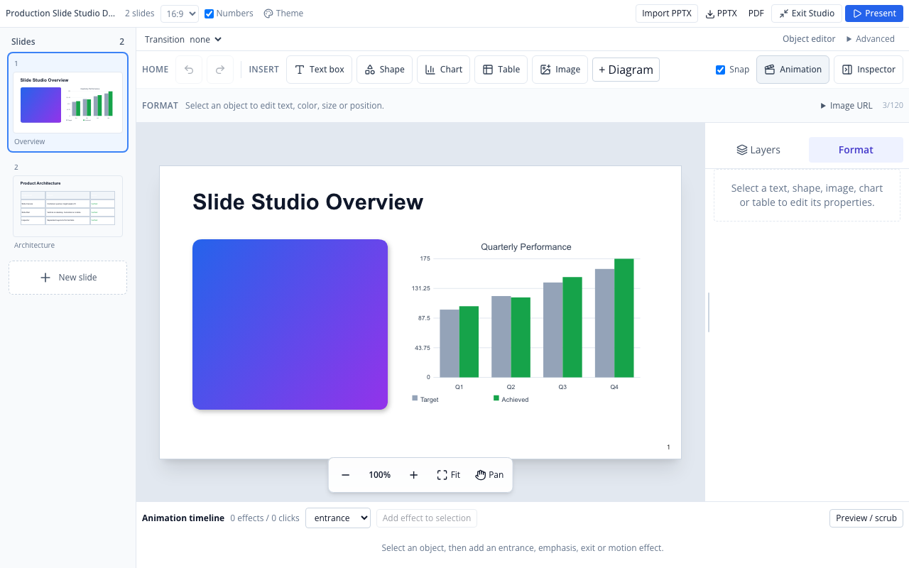
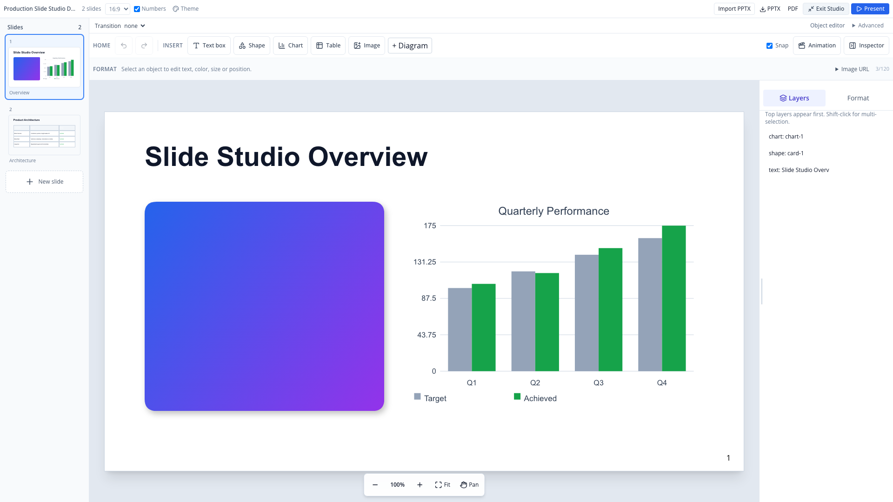
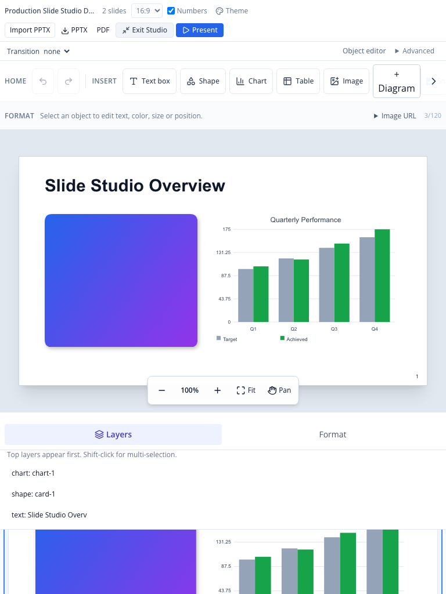
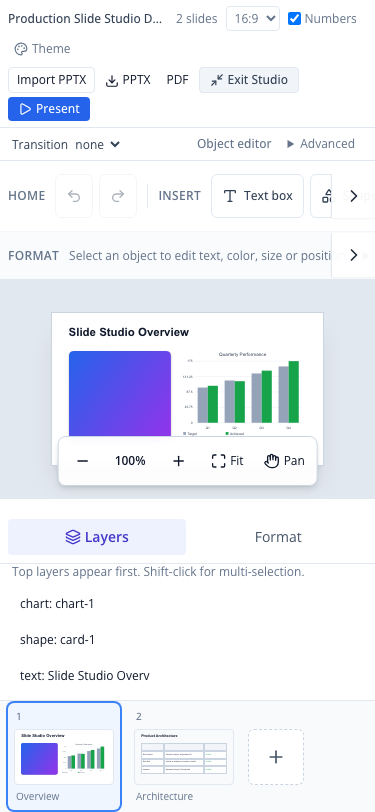

# Slide Studio — Real Browser Visual Acceptance Gallery

Date: 2026-10-20  
HEAD: `6a261fa0`  
PR: [#56](https://github.com/eddyvn98/workspace/pull/56)  
Branch: `feat/office-slide-scene-v2`  
Harness: Playwright Chromium against production build (`pnpm build` + `next start`) on port 3140.

---

## 1. Summary of Measured Viewports & DOM Bounding Boxes

| Viewport | Target Device | Canvas Stage (px) | Aspect Ratio | Filmstrip Layout | Ribbon Height | Inspector Layout | Studio Exit (Esc) |
|---|---|---|---|---|---|---|---|
| **1920 × 1080** | Full HD Desktop | **1376 × 774** | **1.78 (16:9)** | Vertical left rail (`192 × 1041px`) | 101px (2 rows) | Vertical right rail (`288 × 907px`) | ✅ Exits cleanly |
| **1280 × 800** | Laptop / Desktop | **736 × 414** | **1.78 (16:9)** | Vertical left rail (`192 × 761px`) | 101px (2 rows) | Vertical right rail (`288 × 627px`) | ✅ Exits cleanly |
| **768 × 1024** | iPad Portrait | **704 × 396** | **1.78 (16:9)** | Horizontal bottom rail (`768 × 112px`) | 119px + scroll arrow | Bottom horizontal drawer (`768 × 202px`) | ✅ Exits cleanly |
| **375 × 812** | iPhone Mobile | **274 × 154** | **1.78 (16:9)** | Horizontal bottom rail (`375 × 112px`) | 119px + scroll arrow | Bottom horizontal drawer (`375 × 202px`) | ✅ Exits cleanly |

---

## 2. Visual Screenshots

### Desktop & Laptop (1280 × 800)

#### Default Studio View (Layers Tab Active)

*Observations:*
- Left filmstrip rail cleanly shows slide order with active selection border and "+ New slide" button.
- Always-visible ribbon displays Home (Undo/Redo), 1-click Insert (Text box, Shape, Chart, Table, Image, + Diagram), Snap, Animation toggle, and Inspector toggle.
- Slide canvas is centered with soft drop-shadow; floating Zoom dock (`- 100% + Fit Pan`) rests neatly below canvas.
- Right inspector dock displays object layers (`chart-1`, `card-1`, `text`).

#### Format Tab Active

*Observations:*
- Switching between Layers and Format tab is instant with no layout shifts.
- Format tab guides user to select an object to edit properties.

#### Timeline Animation Dock Open

*Observations:*
- Animation timeline opens smoothly at bottom dock.
- Slide canvas automatically shrinks from `736 × 414` to `494 × 278` preserving strict 16:9 geometry without clipping or overflow.

---

### Full HD Desktop (1920 × 1080)

*Observations:*
- Expansive canvas workspace (`1376 × 774px`).
- Ribbon spacing is generous and uncluttered.
- Visual vector geometry, gradient fill, and chart typography render crisply.

---

### Tablet Portrait (768 × 1024 iPad)

*Observations:*
- Breakpoint shift to `lg:` successfully prevents canvas crushing.
- Canvas maintains spacious `704 × 396px` touch-friendly area.
- Ribbon displays right scroll arrow `>` for tool discovery.
- Filmstrip and Inspector adapt as compact horizontal docks below stage.

---

### Mobile Portrait (375 × 812 iPhone)

*Observations:*
- Fully responsive mobile presentation editor.
- Stage maintains exact 16:9 ratio (`274 × 154px`).
- Ribbon does not wrap into multiple lines; horizontal scroll arrow `>` preserves vertical space.
- Escape key and "Exit Studio" cleanly return to workspace document.
